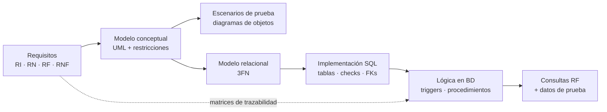
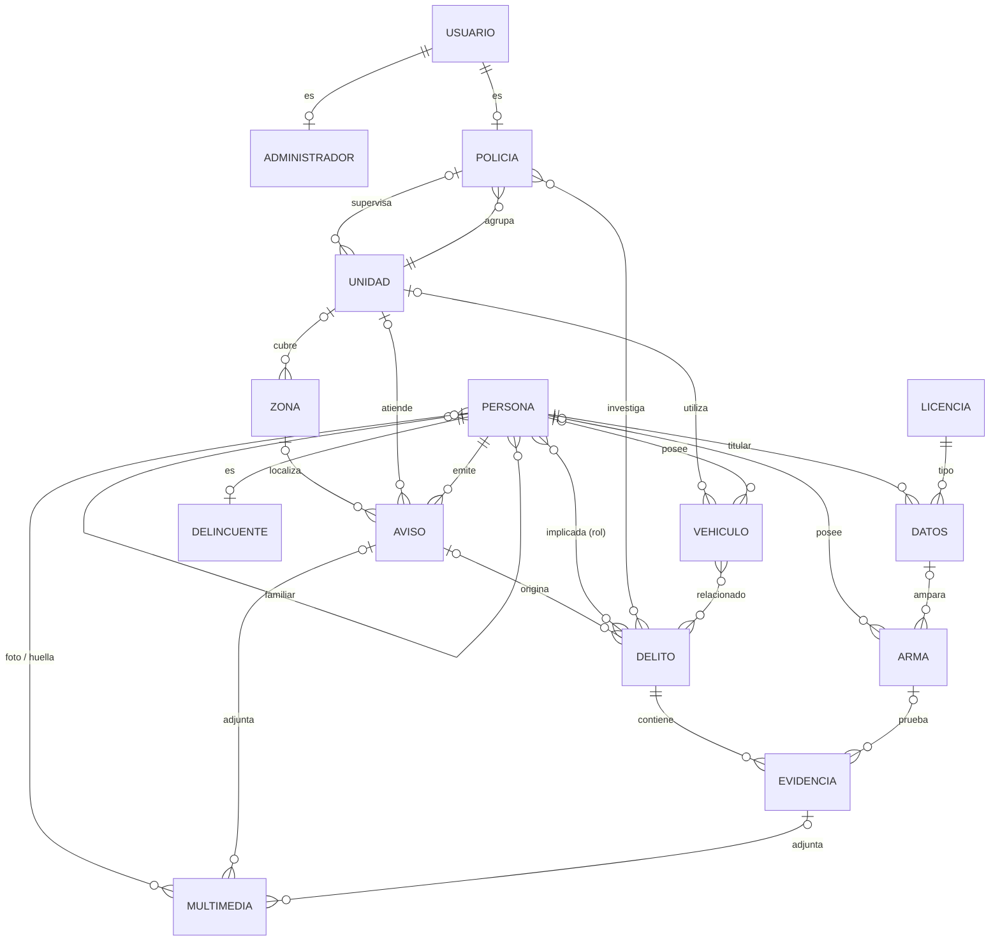

# Comisaría DB — Sistema de información policial

[](https://mariadb.org/)
[](https://mariadb.com/kb/en/stored-routines/)
[](https://plantuml.com/)
[](https://www.informatica.us.es/)

Base de datos relacional para la gestión de una comisaría de policía: ciudadanos, delincuentes, delitos, evidencias, armas, vehículos, avisos y unidades operativas.

El proyecto recorre el ciclo completo de diseño de un sistema de información:

1. Análisis de requisitos.
2. Modelo conceptual en UML.
3. Modelo relacional en 3FN.
4. Implementación en **MariaDB**: las reglas de negocio se aplican dentro de la propia base de datos con *triggers* y procedimientos almacenados.

> Proyecto académico con datos ficticios. No está relacionado con ningún cuerpo policial real.

---

## Índice

- [Comisaría DB — Sistema de información policial](#comisaría-db--sistema-de-información-policial)
  - [Índice](#índice)
  - [Qué incluye](#qué-incluye)
  - [Proceso de diseño](#proceso-de-diseño)
  - [Modelo de datos](#modelo-de-datos)
    - [Diagrama de clases UML](#diagrama-de-clases-uml)
  - [Puesta en marcha](#puesta-en-marcha)
    - [Requisitos](#requisitos)
    - [Opción A: Docker](#opción-a-docker)
    - [Opción B: MariaDB local (Windows)](#opción-b-mariadb-local-windows)
    - [Carga de los scripts](#carga-de-los-scripts)
  - [Ejemplos de uso](#ejemplos-de-uso)
  - [Reglas de negocio implementadas (triggers)](#reglas-de-negocio-implementadas-triggers)
  - [Procedimientos almacenados](#procedimientos-almacenados)
  - [Consultas de los requisitos funcionales](#consultas-de-los-requisitos-funcionales)
  - [Estructura del repositorio](#estructura-del-repositorio)
  - [Documentación del análisis](#documentación-del-análisis)
  - [Contexto académico](#contexto-académico)

---

## Qué incluye

|                                     |                                                                                                                                             |
| ----------------------------------- | ------------------------------------------------------------------------------------------------------------------------------------------- |
| **19 tablas**                       | 15 entidades, 2 jerarquías de herencia (`Usuario → Policía / Administrador`, `Persona → Delincuente`) y 4 tablas N:M                        |
| **11 triggers**                     | Aplican las reglas de negocio RN.03–RN.09 y validan la calidad de los datos                                                                 |
| **11 procedimientos almacenados**   | Operaciones del día a día: control de matrículas, ascensos, sentencias, cadena de custodia…                                                 |
| **9 consultas**                     | Una por cada requisito funcional (RF.01–RF.09)                                                                                              |
| **~1.240 filas de datos de prueba** | 134 personas, 76 delitos, 147 evidencias, 101 vehículos, 100 avisos, 49 policías…                                                           |
| **Análisis completo**               | 13 requisitos de información, 9 reglas de negocio con pruebas de aceptación, diagramas UML, escenarios de prueba y matrices de trazabilidad |

## Proceso de diseño



Cada regla de negocio del análisis tiene su *trigger* en SQL, y cada requisito funcional, su consulta. Las matrices de trazabilidad de la [documentación del análisis](docs/ANALISIS.md) relacionan cada requisito con su implementación.

## Modelo de datos



Decisiones de diseño destacadas:

- **Herencia con una tabla por clase.** Cada subclase (`Policia`, `Administrador`, `Delincuente`) tiene su propia tabla, cuya clave primaria es también clave foránea a la superclase. Así se evitan columnas nulas y se mantiene la 3FN.
- **Dominios cerrados con `ENUM` y `CHECK`.** Rangos policiales, estados procesales, tipos y condiciones de armas, estados de evidencia, situaciones laborales, etc.
- **Relaciones N:M con atributos.** Por ejemplo, el **rol** de una persona en un delito (`VICTIMA`, `SOSPECHOSO`, `CULPABLE`, `TESTIGO`) o el **parentesco** entre personas (32 tipos).
- **Multimedia exclusiva.** Un archivo pertenece a una sola entidad (persona, aviso o evidencia), y un *trigger* lo garantiza.

El modelo relacional completo, con claves primarias, alternativas y foráneas, está en [docs/ANALISIS.md § 7](docs/ANALISIS.md#7-modelo-relacional-en-3fn).

### Diagrama de clases UML

Modelo conceptual con sus restricciones, tal como se diseñó en la fase de análisis:

![Diagrama de clases UML (parte 1)](https://uml.planttext.com/plantuml/svg/dLV1Zjis4BqRy3-mUscxI8mwHwCjujfgQy3TDUmqXnGzp4gpscabKY0b8sYQZyetvCSw92LHjEMDKIzWMSF7uPitmo5tEdbjQj1rKnRJoLVr4vOegW98JYVTtzVYXozyB6QrNHwIWzZjDtUhpMwvJGxNpKmBC4RiK1ibGNoOJeIGgdpGk127MfFChGKgB0hAr7pC-6fep2H5hwGnJKd9BKc4-UMXo8cXkW4t10zAGx4uirZK8wPFSCVMab3MQY7MKACTG5OqKoiw4izCmaiOQyDTnA-E5PfKKsMNMeW_lflDvdzE9nzj6hnGxnZdH6fLYWQtbA9CwOAC0o0pLSQZA5k8ZQmnHzq7bPHa784k8cTz2wms_jDP1-v-DmreKjuXbc3Z3cgcIjOQ37x-14EpfzTE7MMvKmM5Q9eIjTeLa4PUDCYSP-_jeyNtX3FSo5oZKIEKbrb9aWmJovIsAmpLmO9asd1IqQ_D4MGeOKrW8h7wgjXfbQAnXN8uDRbABTnCpteigtR5Meqc95KPvUeDLVH8AVYw60n7zH9aSV6VLcHWcKJliJ17CkDCQgfOIMQY72QGSw_dLHIMxxVQcGP2v3O32_6BVVH-EIsoZskxXH8oU4w_j_X4QLEql0FHpcwjfSgmK4EHIk2VF0nnjHPA3mrMkwN1lF54VrAgG90khPy_gP_XGO_bHQk763vWcnnv7uLzUb7c7lTCedrckumEPWnJgaiuLSRQnbNn6-s0cl1a5sVaLrzrFpidIbEEF73ldjuwR0-ICiZQOErKgEaOhHbuUQoh8QwPnWMpX-n2X_YjAMegCUkanFSrIdCYKQEZTZGgvCVh3xfVatt2HzpoolEjwutV__lofUWxL6IDUj5qqfs5RcpGYon5gRWdAIdO-BSDvWCFgh8gi8ONlCtCNusiWOD1cGcBlJwiVR9ThZRtTto69tTlzedztgoNwslFyM7JlBcz4SpTFjhEjX0LNp8uzWe4Il7ZT18sGOUUpsRH1DISJ4nHWCNtMtpCER44N5QPQfsVWMtBkEbl6VRS5PLM5Q4jp0pj7BTBBk5FmMr9nzHzwsJdyaZSi3pl3ZdlMVVa70qmb4lBt59m3c8EVOmQAwLh25JzU406HPtZqv1k8r-5QrcM9MziY-qEsr5vvP7x3ELkyKwK0J3ez0WbyM6dMva6-tDKMPwWU8MBu27ogU7h7fWHSAH2UnX1mptZIonwnJh1-jX2jbf_5e1yBL8sj74LkjlNWjiP5wxrv-zPivdufiM_w57VTgDdURHPum2CIf-hedTEbBPwMbHSF_CEvFV426EVuD5o-7-Dux1Bk3FotL-i4x6xtsxuxJe_VVczSbifgD56VjOF-Wb1kzi1sZICPpd01_EQ6oB_Y_CV)


Los escenarios de prueba con diagramas de objetos («Atraco a mano armada» y «Redada policial») están en [docs/ANALISIS.md § 5.2](docs/ANALISIS.md#52-escenarios-de-prueba).

## Puesta en marcha

### Requisitos

- **MariaDB 10.11** o superior (probado en 10.11.14, en Windows y en Linux).

### Opción A: Docker

```bash
docker run -d --name comisaria-db \
  -e MARIADB_ROOT_PASSWORD=root \
  -e MARIADB_DATABASE=comisaria \
  -p 3306:3306 \
  mariadb:10.11
```

### Opción B: MariaDB local (Windows)

Crea la base de datos desde HeidiSQL, DBeaver o la consola:

```sql
CREATE DATABASE comisaria;
```

### Carga de los scripts

Crea la estructura y carga los datos:

```bash
mariadb -u root -p comisaria < 1.scripts_tablas_restricciones.sql     # tablas, PK, FK, CHECK
mariadb -u root -p comisaria < 2.scripts_funciones_procedimientos.sql  # 11 procedimientos
mariadb -u root -p comisaria < 4.scripts_triggers.sql                  # 11 triggers (reglas de negocio)
mariadb -u root -p comisaria < 5.script_poblado_tablas.sql             # datos de prueba
```

Lanza las consultas de los requisitos funcionales:

```bash
mariadb -u root -p comisaria < 3.scripts_cursores_consultas.sql        # consultas RF.01–RF.09
```

Los datos de prueba se cargan con los *triggers* ya activos, así que también cumplen todas las reglas de negocio. Los scripts se pueden volver a ejecutar: el primero borra y recrea las tablas.

> Con Docker, cambia `mariadb -u root -p` por `docker exec -i comisaria-db mariadb -uroot -proot` en cada comando.

## Ejemplos de uso

Salidas reales obtenidas con los datos de prueba.

**Control de tráfico:** comprobar una matrícula durante un control.

```sql
CALL p_control_trafico_matricula('0000-BXX', @alerta);
SELECT @alerta;
-- ALERTA MÁXIMA: VEHÍCULO ROBADO.

CALL p_control_trafico_matricula('CNP-1111', @alerta);
SELECT @alerta;
-- OK: Todo correcto. Dueño: Vehículo oficial
```

**RN.06 (vehículo robado):** al marcar un vehículo como robado se generan automáticamente un aviso y un delito, con el propietario como víctima.

```sql
UPDATE Vehiculo SET robado = 1 WHERE matricula = '9821-LXZ';

SELECT a.tipoAviso, d.descripcion, d.estadoProcesal, r.rol
FROM Delito d
JOIN Aviso a USING (id_aviso)
JOIN Rel_Persona_Delito r USING (id_delito)
ORDER BY d.id_delito DESC LIMIT 1;
-- ALARMA | Robo: 9821-LXZ | PENDIENTE | VICTIMA
```

**Riesgo de una zona:** una zona es de riesgo alto si tiene más de 10 avisos.

```sql
CALL p_evaluar_riesgo_zona(1, @riesgo);
SELECT @riesgo;
-- ALTO
```

**RN.05 (trazabilidad):** los delitos no se pueden borrar, solo archivar.

```sql
DELETE FROM Delito WHERE id_delito = 1;
-- ERROR 1644 (45000): Acción Ilegal: Por la RN.05 (Trazabilidad), está prohibido borrar delitos.
--                     Use UPDATE para cambiar el estado a ARCHIVADO.
```

**Validación de matrícula española:** 4 cifras y 3 consonantes, o el formato policial `CNP-XXXX`.

```sql
INSERT INTO Vehiculo (matricula, tipo) VALUES ('1234-AEI', 'COCHE');
-- ERROR 1644 (45000): Formato Inválido: La matrícula debe ser 4 números y 3 letras consonantes
--                     (Ej: 1234-BBB) o formato policial (CNP-XXXX).
```

**RF.01:** delito con su sospechoso y el vehículo implicado (columnas resumidas).

```text
id_delito | descripcion                                | estadoProcesal   | alias    | matricula | modelo                    | estaAsegurado | robado
1         | Conduccion temeraria y vehiculo sin seguro | EN_INVESTIGACION | El Cuqui | 6969-CPC  | Mercedes CLK Descapotable | 0             | 0
```

## Reglas de negocio implementadas (triggers)

| Trigger                                    | Evento                     | Regla                                                                                                                  |
| ------------------------------------------ | -------------------------- | ---------------------------------------------------------------------------------------------------------------------- |
| `trg_check_rango_supervisor_unidad`        | `BEFORE INSERT` Unidad     | **RN.03**: el supervisor de una unidad debe ser COMISARIO o superior                                                   |
| `trg_check_minimo_agentes_unidad`          | `BEFORE UPDATE` Aviso      | **RN.03**: solo se asignan a un aviso unidades con al menos 2 agentes                                                  |
| `trg_bloqueo_manipulacion_evidencia`       | `BEFORE UPDATE` Evidencia  | **RN.04**: una evidencia analizada de un caso cerrado no se puede modificar                                            |
| `trg_impedir_borrado_delito`               | `BEFORE DELETE` Delito     | **RN.05**: los delitos no se borran, solo se archivan                                                                  |
| `trg_auto_aviso_robo_simple`               | `AFTER UPDATE` Vehículo    | **RN.06**: marcar un vehículo como robado genera automáticamente un aviso y un delito, con el propietario como víctima |
| `trg_validar_resolucion_delito`            | `BEFORE UPDATE` Delito     | **RN.07**: un delito solo se resuelve con todas sus evidencias analizadas y los sospechosos procesados                 |
| `trg_validar_persona_en_delito`            | `BEFORE UPDATE` Delito     | **RN.08**: un delito no avanza de `INICIADO` sin al menos una persona asociada                                         |
| `trg_validar_evidencia_con_delito`         | `BEFORE INSERT` Evidencia  | **RN.09**: toda evidencia debe estar vinculada a un delito                                                             |
| `trg_validar_datos_obligatorios_evidencia` | `BEFORE INSERT` Evidencia  | **RN.09**: tipo, descripción y lugar son obligatorios                                                                  |
| `trg_validar_formato_matricula`            | `BEFORE INSERT` Vehículo   | Formato de matrícula española o policial                                                                               |
| `check_multimedia_exclusivity`             | `BEFORE INSERT` Multimedia | Un archivo multimedia pertenece a una sola entidad                                                                     |

## Procedimientos almacenados

| Procedimiento                    | Parámetros                                              | Qué hace                                                                             |
| -------------------------------- | ------------------------------------------------------- | ------------------------------------------------------------------------------------ |
| `p_control_trafico_matricula`    | `IN matricula`, `OUT alerta`                            | Indica en tiempo real si un vehículo es robado o no tiene seguro                     |
| `p_analisis_peligrosidad_sujeto` | `IN dni`, `OUT resultado`                               | Clasifica a un sujeto en peligrosidad alta, media o baja según sus delitos y armas   |
| `p_evaluar_riesgo_zona`          | `IN id_zona`, `OUT nivel`                               | Marca una zona como de riesgo alto si tiene más de 10 avisos                         |
| `p_reportar_sospechoso`          | `IN dni`, `IN id_delito`                                | Vincula a una persona a un delito como sospechosa, evitando duplicados               |
| `p_registrar_evidencia_escena`   | `IN id_delito`, `IN tipo`, `IN descripcion`, `IN lugar` | Registra una evidencia y bloquea la acción si el caso está cerrado                   |
| `p_actualizar_sentencia`         | `IN id_persona`, `IN estado`, `IN dias`                 | Aplica el resultado de un juicio: condena (suma días) o absolución (los pone a cero) |
| `p_asignar_arma_a_policia`       | `IN id_arma`, `IN id_propietario`                       | Asigna un arma solo si es legal y está operativa                                     |
| `p_ascenso_automatico`           | `IN id_usuario`                                         | Asciende a Oficial a un agente con 10 o más años de servicio                         |
| `p_reasignar_unidad_operativa`   | `IN id_policia`, `IN id_unidad`                         | Cambia de unidad a un policía, comprobando antes que la unidad de destino existe     |
| `p_jubilar_vehiculo`             | `IN matricula`                                          | Retira el seguro a un vehículo de más de 20 años y lo desvincula de su unidad        |
| `p_cierre_turno_patrulla`        | `IN id_unidad`, `OUT resumen`                           | Resume los avisos del día de una unidad, incluidos los de alta gravedad              |

## Consultas de los requisitos funcionales

El fichero [`3.scripts_cursores_consultas.sql`](3.scripts_cursores_consultas.sql) contiene una consulta por cada requisito funcional:

| RF    | Consulta                                                                                                                    |
| ----- | --------------------------------------------------------------------------------------------------------------------------- |
| RF.01 | Delito con su sospechoso o culpable y el estado de sus vehículos (asegurado o robado)                                       |
| RF.02 | Aviso con la unidad asignada, sus agentes (ordenados por rango) y sus vehículos                                             |
| RF.03 | Historial de antecedentes y situación procesal de una persona a partir de su DNI                                            |
| RF.04 | Armas deterioradas o ilegales que son evidencia en homicidios o atracos                                                     |
| RF.05 | Policías que han investigado más de 5 delitos en el último año con armas de un mismo número de serie                        |
| RF.06 | Trazabilidad completa arma → evidencia → delito → policía investigador                                                      |
| RF.07 | Víctimas de robo con fuerza con licencia de armas y un vehículo asegurado                                                   |
| RF.08 | Multimedia de personas con antecedentes que no constan como delincuentes, en casos llevados por mandos superiores a Oficial |
| RF.09 | Recursos (agentes y vehículos) de las unidades asignadas a un aviso que tienen al menos 2 agentes                           |

## Estructura del repositorio

```
.
├── 1.scripts_tablas_restricciones.sql     # DDL: 19 tablas, PK, FK, UNIQUE, CHECK, ENUM
├── 2.scripts_funciones_procedimientos.sql # 11 procedimientos almacenados
├── 3.scripts_cursores_consultas.sql       # Consultas RF.01–RF.09
├── 4.scripts_triggers.sql                 # 11 triggers (reglas de negocio)
├── 5.script_poblado_tablas.sql            # Datos de prueba ficticios
├── docs/
│   └── ANALISIS.md                        # Memoria completa del análisis y diseño
├── NORMA.md                               # Enunciado y normas del proyecto
└── README.md
```

## Documentación del análisis

La memoria completa está en **[docs/ANALISIS.md](docs/ANALISIS.md)**:

1. Introducción al problema: contexto, problemática actual y expectativas.
2. Glosario de términos del dominio.
3. Visión general: requisitos generales y usuarios del sistema.
4. Catálogo de requisitos: 13 de información, 9 funcionales, 9 reglas de negocio con pruebas de aceptación, mapa de historias de usuario y 9 no funcionales.
5. Modelo conceptual: diagramas de clases UML y escenarios de prueba («Atraco a mano armada» y «Redada policial»).
6. Matrices de trazabilidad entre requisitos y modelo conceptual.
7. Modelo relacional en 3FN y justificación de la transformación de jerarquías.
8. Matriz de trazabilidad entre el modelo conceptual y SQL.

## Contexto académico

|                |                                                                                       |
| -------------- | ------------------------------------------------------------------------------------- |
| **Asignatura** | Introducción a la Ingeniería del Software y a los Sistemas de Información I (IISSI-1) |
| **Titulación** | Grado en Ingeniería Informática – Ingeniería del Software                             |
| **Centro**     | Escuela Técnica Superior de Ingeniería Informática (ETSII), Universidad de Sevilla    |
| **Curso**      | 2025-26                                                                               |
